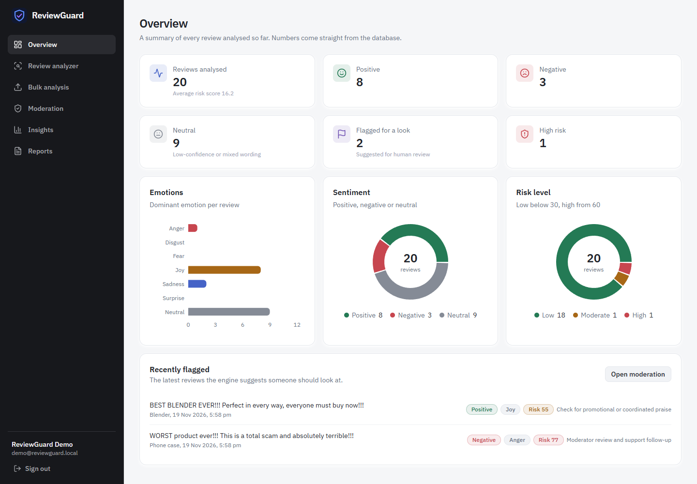

# ReviewGuard

ReviewGuard is a review-analysis and moderation dashboard for retail and e-commerce teams. It analyzes customer reviews for sentiment, emotion, emotionally charged or exaggerated language, and review risk, then helps moderators prioritize reviews that may need attention.

> **Human review is always required.** A risk score or moderation recommendation is a signal for review, not a finding that a review is fake. ReviewGuard does not automatically remove reviews.



## What it does

- Analyze reviews individually and view their sentiment, emotion, language signals, risk score, and suggested next step.
- Upload CSV files for bulk analysis, preview and validate rows, track progress, and export results.
- Review flagged items in a moderation queue and record moderator decisions and notes.
- Explore review trends and summaries with overview, insights, and reporting dashboards.
- Keep review history, analysis results, user accounts, and moderation activity in MongoDB.

## How it works

```text
React dashboard ──> Express API ──> FastAPI analysis service ──> Cloudflare Workers AI
                         │
                         └────────────────────────────────────> MongoDB
```

The browser communicates only with the Express API. Express handles authentication, validation, review storage, moderation, analytics, and exports. The Python service performs analysis and uses Cloudflare Workers AI for sentiment and emotion model calls; it also computes linguistic signals and combines them into a risk score. Express and the AI service share an internal token.

## Tech stack

| Area | Technologies |
|---|---|
| Frontend | React 18, Vite, React Router, Tailwind CSS, Axios, Recharts, Lucide |
| Backend API | Node.js 20+, Express 4, Mongoose, Zod, JWT |
| Analysis service | Python 3.10+, FastAPI, Uvicorn, httpx, VADER Sentiment |
| Data and AI | MongoDB, Cloudflare Workers AI |
| Tests | Vitest, Node.js test runner, pytest |

## Screenshots

Screenshots are in [`docs/screenshots/`](docs/screenshots/). They illustrate the dashboard and workflows; analysis values shown in the screenshots were produced using a test stub and should not be interpreted as live model results.

## Requirements

- Node.js 20 or later and npm
- Python 3.10 or later
- A reachable MongoDB instance (local MongoDB or MongoDB Atlas)
- Cloudflare Workers AI account ID and API token for live model analysis

## Run locally

The API, analysis service, and frontend run as separate processes. Open a terminal for each service. The examples below use PowerShell on Windows; use the equivalent `cd`, virtual-environment activation, and environment-file copy commands in your shell if you are on macOS or Linux.

### 1. Get the project

```powershell
git clone https://github.com/KarakenHunter/ReviewGuard
cd ReviewGuard
```

Start MongoDB locally, or prepare a MongoDB Atlas connection string. The default development URI is `mongodb://127.0.0.1:27017/reviewguard`.

### 2. Configure and start the analysis service

```powershell
cd ai-service
py -m venv .venv
.\.venv\Scripts\Activate.ps1
python -m pip install -r requirements.txt
Copy-Item .env.example .env
```

Edit `ai-service/.env` and set `CLOUDFLARE_ACCOUNT_ID`, `CLOUDFLARE_API_TOKEN`, and `INTERNAL_API_TOKEN`. Use a private token of at least 16 characters for `INTERNAL_API_TOKEN`; the same value must be set for the API in the next step.

```powershell
python -m uvicorn app.main:app --host 127.0.0.1 --port 8001
```

The AI service health endpoint is available at `http://127.0.0.1:8001/health`. Its `/docs` endpoint provides the FastAPI interactive API documentation.

### 3. Configure and start the Express API

In a second terminal at the project root:

```powershell
cd server
npm ci
```

Create `server/.env` with the following development configuration. Use the same `INTERNAL_API_TOKEN` value you configured for the analysis service.

```dotenv
NODE_ENV=development
PORT=8000
MONGODB_URI=mongodb://127.0.0.1:27017/reviewguard
JWT_SECRET=replace-this-with-a-long-random-development-secret
INTERNAL_API_TOKEN=replace-with-the-same-token-as-the-ai-service
AI_SERVICE_URL=http://127.0.0.1:8001
ALLOW_REGISTRATION=true
```

Start the API:

```powershell
npm start
```

The API health endpoint is `http://127.0.0.1:8000/api/health`. Registration is enabled by default in development.

### 4. Start the frontend

In a third terminal at the project root:

```powershell
cd web
npm ci
Copy-Item .env.example .env
npm run dev
```

Open `http://localhost:5173`. In local development, Vite proxies `/api` requests to the Express API on port 8000. Create an account on the sign-in page to use the dashboard.

### Environment configuration

The AI service settings and their defaults are listed in [`ai-service/.env.example`](ai-service/.env.example). The frontend's optional API URL and development proxy settings are in [`web/.env.example`](web/.env.example).

For production, configure secrets through your hosting provider rather than committing `.env` files. Set `NODE_ENV=production` for Express and `APP_ENV=production` for the AI service. Express requires `MONGODB_URI`, a `JWT_SECRET` of at least 32 characters, an `INTERNAL_API_TOKEN` of at least 16 characters, `AI_SERVICE_URL`, and an explicit `CORS_ORIGINS` allow-list. The internal token must match on both services. Configure the frontend's `VITE_API_URL` as the deployed API base URL ending in `/api`.

## Tests

Run each command from the corresponding service directory:

```powershell
# AI service tests (mocked Cloudflare responses)
cd ai-service
python -m pytest -q

# Express API and unit tests (requires MongoDB; see server/tests/helpers.js for test URI)
cd ..\server
npm test

# Frontend unit tests
cd ..\web
npm test
```

The AI service's live Cloudflare test requires valid credentials and is skipped when they are not configured. The Express integration test starts the real FastAPI service but uses a fake Cloudflare endpoint; it checks service integration, not model quality:

```powershell
cd server
npm run test:integration
```

## Project structure

```text
ReviewGuard/
├── ai-service/             FastAPI analysis service
│   ├── app/analyzers/       Sentiment, emotion, and linguistic analysis
│   ├── app/risk_engine/     Risk scoring, classification, and mitigation
│   ├── app/models/          Cloudflare Workers AI client
│   ├── app/schemas/         Request and response schemas
│   └── tests/               Unit, live, and Cloudflare-stub tests
├── server/                  Express API and MongoDB integration
│   ├── src/controllers.js   API request handlers
│   ├── src/models/          MongoDB models
│   ├── src/services/        Analysis, auth, moderation, and analytics
│   └── tests/               API, unit, and integration tests
├── web/                     React + Vite dashboard
│   ├── src/pages/           Analyzer, bulk, moderation, and dashboards
│   ├── src/components/      Shared UI, layout, and analysis components
│   ├── src/lib/             API client, CSV handling, and utilities
│   └── public/              Static assets and sample CSV
├── docs/                    API documentation and screenshots
├── sample-data/             Sample CSV reviews
└── scripts/                 Local end-to-end test helper
```

## API documentation

The backend API routes, request formats, filters, response codes, and data model are documented in [`docs/BACKEND.md`](docs/BACKEND.md). The FastAPI interactive documentation is served at `/docs` when the analysis service is running.

## Limitations

- The model configuration and outputs have not been verified against live Cloudflare Workers AI credentials or MongoDB Atlas in every deployment environment.
- Risk scores and thresholds are heuristic signals, not a validated fraud classifier; they have not been calibrated against a labeled fraud dataset.
- Emotion labels are model-generated, and neutral sentiment uses a heuristic. Analysis may be inaccurate and should be interpreted by a person.
- Screenshots and tests that use the Cloudflare stub demonstrate application wiring and interface behavior, not model accuracy.
- Prompt-injection protections for emotion analysis are partial.

## Security

Never commit credentials, API tokens, production secrets, or populated `.env` files. Use strong, unique secrets and restrict production `CORS_ORIGINS` to trusted frontend origins.
